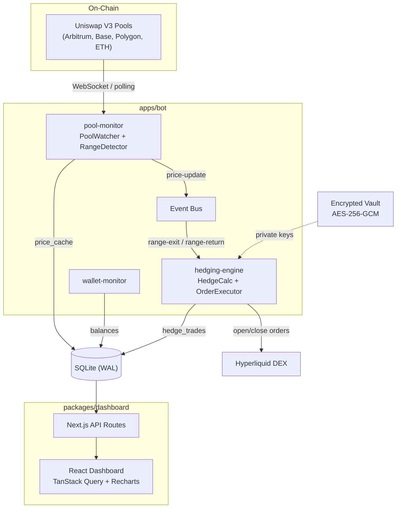

# Trading Bot CGR

[](https://github.com/frxnnk/trading-bot-cgr/actions/workflows/ci.yml)


Bot de cobertura automatizada contra **Impermanent Loss** en pools de liquidez concentrada (Uniswap V3). Cuando el precio sale del rango configurado, el bot abre posiciones de hedge en **Hyperliquid DEX** (perpetuos) para compensar la perdida. Cuando vuelve al rango, cierra las posiciones automaticamente.

<!-- Screenshots — replace placeholders when captures are available -->
<!--  -->
<!--  -->

---

## Quick Start

```bash
# 1. Clonar e instalar
git clone https://github.com/frxnnk/trading-bot-cgr.git
cd trading-bot-cgr
pnpm install

# 2. Seedear datos de prueba y abrir el dashboard
pnpm testnet-seed
pnpm dev:dashboard
# Abrir http://localhost:3000
```

Para el setup completo con precios reales y hedging, ver [Setup](#setup).
Para una guia E2E paso a paso en testnet, ver [docs/TESTNET_GUIDE.md](docs/TESTNET_GUIDE.md).

---

## Indice

- [Quick Start](#quick-start)
- [Prerequisitos](#prerequisitos)
- [Arquitectura](#arquitectura)
- [Flujo de datos](#flujo-de-datos)
- [Estructura del monorepo](#estructura-del-monorepo)
- [Base de datos](#base-de-datos)
- [Dashboard](#dashboard)
- [Logica de hedging](#logica-de-hedging)
- [Setup](#setup)
- [Configuracion](#configuracion)
- [Scripts disponibles](#scripts-disponibles)
- [Testing](#testing)
- [Calidad de codigo](#calidad-de-codigo)
- [Docker](#docker)
- [CI/CD](#cicd)
- [shadcn/ui](#shadcnui)
- [Troubleshooting](#troubleshooting)
- [Decisiones tecnicas](#decisiones-tecnicas)
- [Stack](#stack)

---

## Prerequisitos

| Herramienta | Version minima | Verificar con   |
| ----------- | -------------- | --------------- |
| Node.js     | 20.0.0         | `node -v`       |
| pnpm        | 9.0.0          | `pnpm -v`       |
| Git         | cualquiera     | `git --version` |

> **Recomendado**: Node.js 22+ (usa `import.meta.dirname` nativo en el bot).

Si no tenes pnpm:

```bash
npm install -g pnpm
```

---

## Arquitectura



El bot y el dashboard son **dos procesos separados** que comparten la misma base de datos SQLite. El bot escribe (precios, hedges, trades) y el dashboard lee y muestra.

---

## Flujo de datos

### 1. Monitoreo de precio

```
Pool Uniswap V3
    |
    +-- WebSocket: Swap events en tiempo real (preferido)
    |   `-- Si WS falla -> fallback a polling slot0 cada 5s
    |
    v
PoolWatcher
    |  Extrae sqrtPriceX96 + tick -> calcula currentPrice
    |
    v
PriceFeed (cache en memoria) + DB (price_cache)
    |
    v
RangeDetector (maquina de estados)
    |  Compara currentPrice vs [rangeLower, rangeUpper]
    |  Requiere 3 updates consecutivos para confirmar transicion
    |  Cooldown post-retorno para evitar whipsaw
    |
    +-- RANGE EXIT  --> HedgingEngine.onRangeExit()
    `-- RANGE RETURN --> HedgingEngine.onRangeReturn()
```

### 2. Apertura de hedge (range exit)

```
RangeDetector confirma salida
    |
    v
HedgingEngine.onRangeExit()
    |
    +-- 1. Verificar pool activo + sin hedge abierto
    +-- 2. HedgeCalculator: size = poolAmount / currentPrice
    |     Exit below -> SHORT | Exit above -> LONG
    +-- 3. OrderExecutor.openHedge()
    |     +-- Protection wallet: market order (IOC limit + 1% slippage)
    |     `-- Profit wallet (opcional): mirror trade
    +-- 4. PositionTracker.recordOpen() -> DB hedge_trades
    `-- 5. Actualizar pool status -> out-of-range-below/above
```

### 3. Cierre de hedge (range return)

```
RangeDetector confirma retorno
    |
    v
HedgingEngine.onRangeReturn()
    |
    +-- 1. Buscar hedges abiertos del pool
    +-- 2. Calcular PnL:
    |     Short: (entryPrice - exitPrice) * size
    |     Long:  (exitPrice - entryPrice) * size
    +-- 3. Marcar false breakout si PnL < 0
    +-- 4. OrderExecutor.closeHedge() -> reduceOnly orders
    +-- 5. PositionTracker.recordClose() -> DB
    `-- 6. Pool status -> in-range + activar cooldown
```

---

## Estructura del monorepo

```
trading-bot-cgr/
├── apps/
│   └── bot/                          # Proceso principal del bot
│       └── src/
│           ├── main.ts               # Bootstrap: init todo, registrar pools, arrancar
│           ├── config.ts             # Carga .env + defaults
│           └── event-bus.ts          # EventEmitter tipado (price-update, range-exit, etc.)
│
├── packages/
│   ├── common/                       # Tipos, constantes y utilidades compartidas
│   ├── db/                           # SQLite (WAL), 6 tablas, repository pattern
│   ├── security/                     # AES-256-GCM vault para private keys
│   ├── pool-monitor/                 # viem multi-chain, Swap events WS + slot0 polling
│   ├── hedging-engine/               # @nktkas/hyperliquid SDK, hedge calc, order exec
│   └── dashboard/                    # Next.js 15 + shadcn/ui, monitoring UI
│
├── scripts/                          # Setup & seed scripts
├── .github/workflows/ci.yml          # GitHub Actions CI
├── Dockerfile                        # Multi-stage (bot + dashboard targets)
├── docker-compose.yml                # Bot + Dashboard con volumen compartido
└── LICENSE                           # Proprietary
```

### Dependencias entre packages

```
common <--- db <--- security
  ^          ^         ^
  |          |         |
  +-- pool-monitor     |
  |          |         |
  `-- hedging-engine --'
              ^
              |
           apps/bot --> todos los packages
           dashboard --> db, common
```

---

## Base de datos

SQLite con WAL mode. 6 tablas:

### `wallets`

| Columna               | Tipo        | Descripcion                                      |
| --------------------- | ----------- | ------------------------------------------------ |
| id                    | TEXT PK     | UUID                                             |
| alias                 | TEXT UNIQUE | Nombre legible (`pool-eth-arb`, `profit-global`) |
| address               | TEXT        | Direccion de la wallet en Hyperliquid            |
| wallet_type           | TEXT        | `protection` o `profit`                          |
| available_balance     | TEXT        | Balance disponible en USD                        |
| margin_used           | TEXT        | Margen en uso                                    |
| total_balance         | TEXT        | Balance total                                    |
| low_balance_threshold | TEXT        | Umbral de alerta                                 |
| is_low_balance        | INTEGER     | Flag 0/1                                         |
| balance_updated_at    | TEXT        | Ultimo chequeo                                   |
| created_at            | TEXT        | Timestamp de creacion                            |

### `pool_configs`

| Columna                      | Tipo    | Descripcion                                                                   |
| ---------------------------- | ------- | ----------------------------------------------------------------------------- |
| id                           | TEXT PK | UUID                                                                          |
| name                         | TEXT    | Nombre descriptivo                                                            |
| chain_id                     | INTEGER | 1, 42161, 8453, 137                                                           |
| chain_name                   | TEXT    | Ethereum, Arbitrum, Base, Polygon                                             |
| pool_address                 | TEXT    | Address del pool Uniswap V3                                                   |
| token0_symbol, token1_symbol | TEXT    | Par (WETH/USDC)                                                               |
| fee_tier                     | INTEGER | 100, 500, 3000, 10000 bps                                                     |
| range_lower, range_upper     | REAL    | Rango de precio configurado                                                   |
| pool_amount                  | TEXT    | Monto en USD a cubrir                                                         |
| hedge_asset                  | TEXT    | Asset a hedgear en HL (ETH, BTC)                                              |
| leverage                     | INTEGER | Multiplicador (5x, 10x, 20x)                                                  |
| protection_direction         | TEXT    | `both`, `below`, `above`                                                      |
| protection_wallet_id         | TEXT FK | Wallet asignada                                                               |
| profit_wallet_enabled        | INTEGER | 0/1                                                                           |
| protection_active            | INTEGER | 0/1 (toggle desde el dashboard)                                               |
| status                       | TEXT    | `in-range`, `out-of-range-below`, `out-of-range-above`, `monitoring`, `error` |
| current_price                | TEXT    | Ultimo precio leido                                                           |
| created_at, updated_at       | TEXT    | Timestamps                                                                    |

### `hedge_trades`

| Columna              | Tipo    | Descripcion                           |
| -------------------- | ------- | ------------------------------------- |
| id                   | TEXT PK | UUID                                  |
| pool_config_id       | TEXT FK | Pool asociado                         |
| wallet_id            | TEXT FK | Wallet que ejecuto                    |
| asset                | TEXT    | ETH, BTC, etc.                        |
| side                 | TEXT    | `short` o `long`                      |
| size                 | TEXT    | Cantidad de asset                     |
| entry_price          | TEXT    | Precio de entrada                     |
| exit_price           | TEXT    | Precio de salida (null si abierto)    |
| leverage             | INTEGER | Leverage usado                        |
| status               | TEXT    | `open`, `closed`, `liquidated`        |
| realized_pnl         | TEXT    | PnL realizado al cerrar               |
| fees                 | TEXT    | Fees pagados                          |
| hl_order_id          | TEXT    | Order ID de Hyperliquid               |
| close_reason         | TEXT    | `range-return`, `stop-loss`, `manual` |
| is_false_breakout    | INTEGER | 1 si PnL < 0 al cerrar                |
| opened_at, closed_at | TEXT    | Timestamps                            |

### `trade_log`

Audit log de cada request/response al API de Hyperliquid.

### `pnl_snapshots`

Snapshots periodicos de PnL por pool para graficos historicos.

### `price_cache`

Cache de precios por asset y chain para el dashboard.

---

## Dashboard

Next.js 15 + React 19 + TailwindCSS 4 + shadcn/ui. Dark theme. Auto-refresh cada 5s via TanStack Query.

| Pagina      | Ruta              | Que muestra                                                                                          |
| ----------- | ----------------- | ---------------------------------------------------------------------------------------------------- |
| Overview    | `/`               | Cards: pools activos, in-range, hedges abiertos, PnL total, false breakouts. Alertas de low balance. |
| Pools       | `/pools`          | Lista de pools con status, precio actual, rango. Toggle de proteccion.                               |
| Pool Detail | `/pools/:id`      | Grafico precio 24h, config, rango visual, historial de hedges del pool.                              |
| New Pool    | `/pools/new`      | Formulario: chain, pool address, tokens, fee tier, rango, monto, leverage, direccion.                |
| Edit Pool   | `/pools/:id/edit` | Editar configuracion de un pool existente.                                                           |
| Wallets     | `/wallets`        | Lista de wallets con balances, tipo, alertas. Form para agregar wallet.                              |
| Hedges      | `/hedges`         | Posiciones abiertas con PnL no realizado. Boton cierre manual.                                       |
| History     | `/history`        | Tabla de trades cerrados, PnL realizado, filtro false breakouts (Switch).                            |
| Settings    | `/settings`       | Configuracion del bot.                                                                               |
| Landing     | `/landing`        | Landing page del producto.                                                                           |

### API Routes

```
GET    /api/stats              # Overview stats (pools, hedges, PnL, low balance)
GET    /api/pools              # Listar pools
POST   /api/pools              # Crear pool
GET    /api/pools/:id          # Pool individual con precio actual
PUT    /api/pools/:id          # Actualizar pool
DELETE /api/pools/:id          # Eliminar pool
POST   /api/pools/:id/toggle   # Toggle proteccion activa
GET    /api/wallets            # Listar wallets con balances
POST   /api/wallets            # Crear wallet (metadata, sin private key)
GET    /api/hedges             # Hedges abiertos
POST   /api/hedges/:id/close   # Cerrar hedge manualmente
GET    /api/trades             # Historial paginado (?limit=100&offset=0)
GET    /api/prices             # Precios cacheados para graficos
GET    /api/pnl                # Snapshots de PnL para grafico cumulative
GET    /api/bot-status         # Heartbeat del bot (freshness check cada 10s)
```

---

## Logica de hedging

### Calculo de size

```
hedgeSize = poolAmount (USD) / currentPrice

Ejemplo:
  poolAmount = $10,000
  currentPrice = $2,500 (ETH)
  hedgeSize = 4.0000 ETH
```

### Direccion del hedge

| Evento                             | Significado para LP                                     | Hedge           |
| ---------------------------------- | ------------------------------------------------------- | --------------- |
| Precio baja del rango (exit below) | LP acumula mas del token volatil (ETH) → pierde valor   | **SHORT** en HL |
| Precio sube del rango (exit above) | LP acumula mas del token estable (USDC) → pierde upside | **LONG** en HL  |

### Ordenes en Hyperliquid

- **Tipo**: IOC limit order (Immediate-Or-Cancel) con 1% de slippage sobre el precio actual
- **Leverage**: Configurable por pool (5x, 10x, 20x)
- **Cierre**: `reduceOnly` order cuando el precio vuelve al rango
- **Stop Loss**: Trigger order de backup que se coloca al abrir el hedge
- **SDK**: `@nktkas/hyperliquid` con field names cortos (`a`, `b`, `p`, `s`, `t`, `r`)

### Range Detector (maquina de estados)

```
                    ┌──────────────┐
     ┌──────────────│   IN RANGE   │◄─────────────────┐
     │              └──────┬───────┘                   │
     │                     │                           │
     │         Precio sale del rango                   │
     │         (3 updates consecutivos)     Precio vuelve al rango
     │                     │                (3 updates consecutivos)
     │                     v                           │
     │  ┌──────────────────────────────────┐           │
     │  │  OUT OF RANGE (below o above)    │───────────┘
     │  │  → dispara hedge                 │
     │  └──────────────────────────────────┘
     │
     │  Cooldown de N minutos post-retorno
     │  para evitar whipsaw
     └─────────────────────────────────────
```

### Wallets

- **Protection wallet**: Una por pool. Ejecuta el hedge principal.
- **Profit wallet** (opcional): Una global compartida. Mirror trade para separar ganancias.

Las private keys se guardan en un vault encriptado con AES-256-GCM + scrypt KDF. El archivo vault se guarda fuera del repo (`~/.trading-bot-cgr/vault.enc` por default). **Nunca se almacenan private keys en la DB ni en archivos `.env`.**

---

## Setup

Hay 3 niveles de setup, desde "solo ver la UI" hasta "hedging real en testnet":

### Nivel 1 — Solo Dashboard (sin dependencias externas)

Ver la UI, crear pools manualmente, sin datos en vivo. No necesita nada externo.

```bash
git clone https://github.com/frxnnk/trading-bot-cgr.git
cd trading-bot-cgr
pnpm install
pnpm testnet-seed      # Crea DB con datos de prueba (wallets con addresses dummy)
pnpm dev:dashboard     # http://localhost:3000
```

**Que ves**: pools listados, wallets con addresses de prueba, formulario de creacion, todo sin precios reales.

### Nivel 2 — Dashboard + Bot con precios reales

Necesitas: una API key de [Alchemy](https://www.alchemy.com) (gratis) o cualquier RPC de Arbitrum.

```bash
# 1. Crear archivo de configuracion
cp .env.example .env
```

Editar `.env`:

```env
RPC_ARBITRUM=https://arb-mainnet.g.alchemy.com/v2/TU_KEY
WS_ARBITRUM=wss://arb-mainnet.g.alchemy.com/v2/TU_KEY   # opcional, mejora reactividad
LOG_LEVEL=info
```

> **Nota**: Sin WS, el bot usa polling HTTP cada 5s. Funciona bien, pero WS da reactividad sub-segundo.

Correr en dos terminales:

```bash
# Terminal 1
pnpm dev:dashboard     # http://localhost:3000

# Terminal 2
pnpm dev:bot           # Logs de precio cada minuto, range detection en tiempo real
```

**Que ves**: el bot lee el precio real de ETH/USDC del pool en Arbitrum. El dashboard muestra el precio actual y si esta in-range o out-of-range. El bot detecta range exits pero no puede hedgear (no hay wallets con keys reales).

### Nivel 3 — E2E con Hyperliquid testnet

#### Opcion A: Setup automatico (recomendado)

```bash
# 1. Configurar .env
cp .env.example .env
```

Editar `.env` con al menos:

```env
VAULT_PASSWORD=elegir-una-contraseña-segura-aqui
RPC_ARBITRUM=https://arb1.arbitrum.io/rpc    # o tu Alchemy key
```

```bash
# 2. Generar wallets, guardar en vault y seedear DB
pnpm setup-testnet
```

El script:

- Genera 2 wallets secp256k1 reales (`pool-eth-arb` + `profit-global`)
- Encripta las private keys en `~/.trading-bot-cgr/vault.enc`
- Registra las wallets en la DB con sus direcciones reales
- Crea un pool ETH/USDC Arbitrum de prueba
- **Muestra las private keys en consola** — copiarlas para importar en MetaMask

```bash
# 3. Importar las private keys en MetaMask
#    Account → Import Account → Paste Private Key

# 4. Fondear en Hyperliquid testnet
#    Ir a https://app.hyperliquid-testnet.xyz
#    Conectar cada wallet con MetaMask
#    Depositar USDC del faucet (~$1000 por wallet minimo)

# 5. Correr bot + dashboard
pnpm dev:bot           # Terminal 1
pnpm dev:dashboard     # Terminal 2
```

#### Opcion B: Setup manual (si ya tenes wallets)

```bash
# Setear VAULT_PASSWORD en .env, luego:
pnpm setup-keys
```

En el CLI interactivo:

1. Agregar wallet con alias `pool-eth-arb` (private key de tu wallet de proteccion)
2. Agregar wallet con alias `profit-global` (private key de tu wallet de profit)
3. Registrar las wallets desde el dashboard (Wallets → + Add Wallet)
4. Crear el pool desde el dashboard (Pools → + Add Pool)

#### Que ves en Nivel 3

El bot abre shorts/longs reales en HL testnet cuando el precio sale del rango. Cuando vuelve, los cierra automaticamente. El dashboard muestra hedges activos, PnL, saldos en tiempo real.

> **Guia detallada**: Para un walkthrough paso a paso con troubleshooting, ver [docs/TESTNET_GUIDE.md](docs/TESTNET_GUIDE.md).

---

## Configuracion

### Variables de entorno (.env)

Copiar `.env.example` a `.env` y editar:

```bash
cp .env.example .env
```

| Variable                   | Default                                | Requerida | Descripcion                                                   |
| -------------------------- | -------------------------------------- | --------- | ------------------------------------------------------------- |
| `VAULT_PASSWORD`           | -                                      | Nivel 3   | Password para encriptar/desencriptar el vault de private keys |
| `VAULT_PATH`               | `~/.trading-bot-cgr/vault.enc`         | No        | Ruta al archivo vault                                         |
| `DB_PATH`                  | `./data/bot.db`                        | No        | Ruta a la base de datos SQLite                                |
| `RPC_ARBITRUM`             | -                                      | Nivel 2+  | URL HTTP del nodo RPC de Arbitrum                             |
| `WS_ARBITRUM`              | -                                      | No        | URL WebSocket del nodo RPC de Arbitrum (mejora reactividad)   |
| `RPC_ETHEREUM`             | -                                      | No        | URL HTTP del nodo RPC de Ethereum                             |
| `WS_ETHEREUM`              | -                                      | No        | URL WebSocket del nodo RPC de Ethereum                        |
| `RPC_BASE`                 | -                                      | No        | URL HTTP del nodo RPC de Base                                 |
| `WS_BASE`                  | -                                      | No        | URL WebSocket del nodo RPC de Base                            |
| `RPC_POLYGON`              | -                                      | No        | URL HTTP del nodo RPC de Polygon                              |
| `WS_POLYGON`               | -                                      | No        | URL WebSocket del nodo RPC de Polygon                         |
| `HL_API_URL`               | `https://api.hyperliquid-testnet.xyz`  | No        | API endpoint de Hyperliquid                                   |
| `HL_WS_URL`                | `wss://api.hyperliquid-testnet.xyz/ws` | No        | WebSocket de Hyperliquid                                      |
| `DEBOUNCE_COUNT`           | `3`                                    | No        | Updates consecutivos para confirmar transicion de rango       |
| `POLLING_INTERVAL_MS`      | `5000`                                 | No        | Intervalo de polling de precio (ms)                           |
| `WALLET_CHECK_INTERVAL_MS` | `30000`                                | No        | Intervalo de chequeo de balances (ms)                         |
| `COOLDOWN_MINUTES`         | `5`                                    | No        | Cooldown post range-return (minutos)                          |
| `DASHBOARD_PORT`           | `3000`                                 | No        | Puerto del dashboard                                          |
| `LOG_LEVEL`                | `info`                                 | No        | Nivel de log: `debug`, `info`, `warn`, `error`                |

### Seguridad de private keys

Las private keys **nunca** se almacenan en `.env`, en la DB, ni en texto plano. El flujo es:

1. `pnpm setup-keys` o `pnpm setup-testnet` → pide master password
2. Las keys se encriptan con AES-256-GCM (scrypt KDF, N=2^17)
3. Se guardan en `~/.trading-bot-cgr/vault.enc` (fuera del repo)
4. Al arrancar, el bot usa `VAULT_PASSWORD` para desencriptar y cargar en memoria
5. Al apagar, las keys se borran de memoria

---

## Scripts disponibles

| Script                 | Descripcion                                                        |
| ---------------------- | ------------------------------------------------------------------ |
| `pnpm dev:bot`         | Arranca el bot en modo desarrollo                                  |
| `pnpm dev:dashboard`   | Arranca el dashboard en http://localhost:3000                      |
| `pnpm build`           | Build de produccion de todos los packages                          |
| `pnpm build:dashboard` | Build de produccion solo del dashboard                             |
| `pnpm typecheck`       | Typecheck de todos los packages (tsc --noEmit)                     |
| `pnpm test`            | Correr todos los tests (62 tests via Vitest)                       |
| `pnpm lint`            | ESLint en todo el proyecto                                         |
| `pnpm lint:fix`        | ESLint con auto-fix                                                |
| `pnpm format`          | Prettier en todo el proyecto                                       |
| `pnpm format:check`    | Verificar formato sin modificar                                    |
| `pnpm testnet-seed`    | Crear DB con datos de prueba (dummy addresses, bueno para Nivel 1) |
| `pnpm setup-testnet`   | Genera wallets reales, las guarda en vault y seedea la DB          |
| `pnpm setup-keys`      | CLI interactivo para gestionar private keys en el vault            |
| `pnpm db:migrate`      | Correr migraciones de la DB                                        |

---

## Testing

### Unit Tests

62 tests via Vitest organizados por package:

| Package        | Tests | Cobertura                                            |
| -------------- | ----- | ---------------------------------------------------- |
| db             | 34    | pools.repo (12), wallets.repo (11), hedges.repo (11) |
| pool-monitor   | 15    | range-detector state machine (15 edge cases)         |
| hedging-engine | 13    | hedge-calculator validations                         |

```bash
pnpm test            # Correr todos los tests
pnpm -r test         # Lo mismo, recursive
```

Test utilities: `packages/db/src/test-utils.ts` provee `createTestDb()` con SQLite in-memory para tests rapidos sin tocar disco.

Cada package tiene su propio `vitest.config.ts`, coordinados por `vitest.workspace.ts` en la raiz.

### E2E Testnet (verificado 2026-03-10)

Ciclo completo de hedge open → close probado en Hyperliquid testnet:

| Paso                   | Resultado                                                    |
| ---------------------- | ------------------------------------------------------------ |
| Bot startup            | Carga vault (2 keys), inicializa HL wallets, registra 1 pool |
| Precio polling         | slot0 cada 5s, precio real ETH/USDC on-chain ($2071)         |
| Range exit detection   | Debounce 3 polls → `out-of-range-below` confirmado           |
| Hedge open             | Short 0.0097 ETH @ $2062.9, IOC filled en 2.4s               |
| Stop-loss backup       | Trigger order colocado @ $2244                               |
| syncPools range update | Detecta cambio de rango en DB en ~30s                        |
| Range return detection | Debounce 3 polls → `in-range` confirmado                     |
| Hedge close            | Posicion cerrada @ $2072.34, PnL: -$0.09                     |
| DB verification        | `status=closed`, `close_reason=range_return`, PnL registrado |
| Manual close via API   | `POST /api/hedges/[id]/close` → cierra hedge y calcula PnL   |

---

## Calidad de codigo

- **ESLint**: Flat config (`eslint.config.js`), typescript-eslint + prettier compat. 0 errores.
- **Prettier**: singleQuote, trailingComma all, printWidth 100 (`.prettierrc.json`).
- **TypeScript**: Strict mode, `tsc --noEmit` en todos los packages. 0 errores.

```bash
pnpm typecheck       # Typecheck todos los packages
pnpm lint            # ESLint
pnpm lint:fix        # ESLint con auto-fix
pnpm format          # Prettier write
pnpm format:check    # Prettier check
```

---

## Docker

Multi-stage Dockerfile con targets separados para bot y dashboard:

```bash
# Build y correr con docker-compose
docker compose up -d

# O individualmente
docker build --target bot -t trading-bot .
docker build --target dashboard -t trading-dashboard .

# Correr el bot con variables de entorno
docker run -d --name bot \
  -v trading-data:/app/data \
  -e VAULT_PASSWORD=tu-password \
  -e RPC_ARBITRUM=https://... \
  trading-bot
```

Los dos containers comparten un volumen `bot-data` para la DB SQLite. El vault se monta por separado.

---

## CI/CD

GitHub Actions (`.github/workflows/ci.yml`): Node 22, pnpm 9.

Pipeline: `install → typecheck → lint → test`

Se ejecuta en push a `main`/`master` y en pull requests.

---

## shadcn/ui

El dashboard usa [shadcn/ui](https://ui.shadcn.com) (estilo new-york, dark theme) con 17 componentes instalados:

`alert`, `badge`, `button`, `card`, `dialog`, `dropdown-menu`, `input`, `label`, `scroll-area`, `select`, `separator`, `skeleton`, `sonner`, `switch`, `table`, `tabs`, `tooltip`

Todos los componentes custom del dashboard usan semantic design tokens (`text-foreground`, `bg-card`, `bg-muted`, `border-border`) en vez de colores hardcodeados (`text-white`, `bg-gray-900`, etc.).

Para agregar un nuevo componente shadcn/ui:

```bash
cd packages/dashboard
npx shadcn@latest add <component-name>
```

Config: `packages/dashboard/components.json`, utility `cn()` en `src/lib/utils.ts`, CSS variables en `src/app/globals.css`.

---

## Troubleshooting

### `SQLITE_BUSY` o errores de lock en la DB

SQLite con WAL mode puede tener problemas si OneDrive (u otro servicio de sync) sincroniza los archivos `.db` mientras el bot escribe. Solucion: mover la DB fuera de OneDrive:

```env
DB_PATH=C:/temp/trading-bot/bot.db
```

### El puerto 3000 ya esta en uso

```bash
# Matar el proceso en el puerto
npx kill-port 3000
# O cambiar el puerto en .env
DASHBOARD_PORT=3001
```

### `ERR_MODULE_NOT_FOUND` al correr scripts

Los scripts en `scripts/` usan imports relativos. Asegurate de correrlos con los comandos de `package.json` (`pnpm setup-testnet`, `pnpm testnet-seed`), no directamente con `tsx`.

### El bot dice "No key found in vault for wallet"

La wallet existe en la DB pero no tiene private key en el vault. Correr:

```bash
pnpm setup-keys
# Agregar la key para el alias que falta
```

### El bot no detecta cambios de precio

1. Verificar que `RPC_ARBITRUM` esta seteado en `.env`
2. Si usas RPC publico, puede estar rate-limited. Conseguir un API key de Alchemy (gratis).
3. Verificar logs con `LOG_LEVEL=debug`

### `scrypt memory limit exceeded`

El vault usa scrypt con N=2^17 que requiere ~128MB. Si tu sistema tiene poca RAM, esto puede fallar. El bot ya incluye `maxmem: 256MB` en la config de scrypt.

### better-sqlite3 no compila

```bash
# En Windows, necesitas build tools
npm install -g windows-build-tools
# O instalar Visual Studio Build Tools con C++ workload

# Luego reinstalar
pnpm install
```

---

## Decisiones tecnicas

| Decision                         | Razon                                                                                                                 |
| -------------------------------- | --------------------------------------------------------------------------------------------------------------------- |
| **Una wallet HL por pool**       | Perpetuos cancelan posiciones opuestas en la misma wallet. Wallets separadas permiten hedges independientes.          |
| **Una wallet de profit global**  | Simplifica la gestion. Las ganancias se consolidan en un solo lugar.                                                  |
| **Config manual de pools**       | No leemos posiciones LP on-chain. El usuario define rangos y montos manualmente via dashboard. Mas simple y flexible. |
| **Market orders = IOC limit**    | HL no tiene market orders nativos. IOC limit con 1% slippage es equivalente.                                          |
| **Debounce de 3 updates**        | Evita abrir/cerrar hedges por spikes momentaneos de precio.                                                           |
| **Cooldown post-retorno**        | Evita whipsaw: si el precio oscila en el borde del rango, no abre/cierra repetidamente.                               |
| **SQLite WAL**                   | Permite lecturas concurrentes (dashboard) mientras el bot escribe. Simple, sin servidor externo.                      |
| **Monorepo con pnpm workspaces** | Packages con responsabilidades claras. Tipos compartidos. Build independiente.                                        |
| **@nktkas/hyperliquid SDK**      | SDK liviano para HL con soporte de signing. Field names cortos: `a` (asset), `b` (isBuy), `p` (price), `s` (size).    |
| **viem para on-chain**           | Type-safe, tree-shakeable, soporte multi-chain con PublicClient.                                                      |
| **shadcn/ui**                    | Componentes copiados al repo (no dependencia), totalmente customizables, design tokens semanticos.                    |
| **Vitest**                       | Rapido, ESM nativo, compatible con el stack TypeScript del proyecto.                                                  |

---

## Stack

| Capa             | Tecnologia                           |
| ---------------- | ------------------------------------ |
| Runtime          | Node.js 22+                          |
| Lenguaje         | TypeScript 5.7+                      |
| Package manager  | pnpm 9+ (workspaces)                 |
| On-chain         | viem (Uniswap V3 pools)              |
| DEX              | @nktkas/hyperliquid (perpetuos)      |
| Base de datos    | SQLite via better-sqlite3 (WAL mode) |
| Dashboard        | Next.js 15, React 19, TailwindCSS 4  |
| UI Components    | shadcn/ui (17 componentes)           |
| Estado client    | TanStack Query (auto-refetch 5s)     |
| Graficos         | Recharts                             |
| Logging          | pino + pino-pretty                   |
| Seguridad        | AES-256-GCM + scrypt KDF             |
| Testing          | Vitest (62 tests)                    |
| Linting          | ESLint + Prettier                    |
| CI/CD            | GitHub Actions                       |
| Containerizacion | Docker multi-stage                   |
| CLI              | @inquirer/prompts                    |
